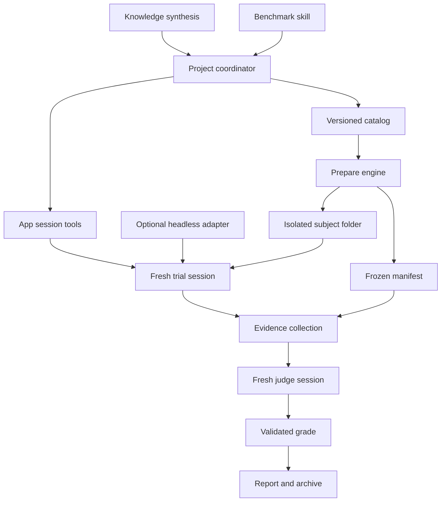

# Benchmark architecture

The trial and judge use different folders and sessions. The coordinator retains
the lab catalog and run records; the subject receives only its fixtures,
selected component configuration, and generated task prompt. Neither folder
separation nor a separate session is a security sandbox.
